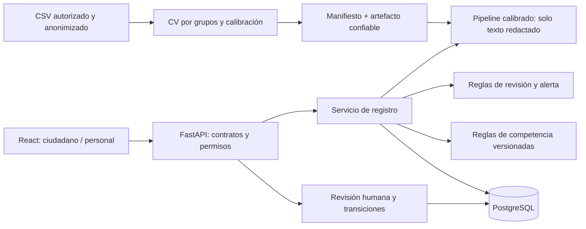

# Arquitectura y contratos

Ampliación Proceso de PLN (14/10/2026): `backend/pln_routes.py` expone simulación pública y operaciones de análisis/clarificación/extracción/relaciones del personal; contratos en `contratos_pln.md`. `ml/trace.py` observa los transform del mismo artefacto ajustado en copias superficiales por petición, sin modificar el modelo compartido ni entrenar. `backend/pln_metadata.py` sirve agregados por hash y reportes compatibles; `frontend/src/PLNProcess.tsx` separa inferencia, experimentación y capacidades.

`analysis_versions` conserva original, respuestas/correcciones, análisis, usuario y versiones. `relation_decisions` registra confirmar/descartar con motivo; ninguna operación fusiona incidencias o altera su estado. `backend/related.py` consulta un índice TF-IDF separado creado offline bajo data/private; snapshot/hash detectan obsolescencia. `IncidentPLN.tsx` integra estas capacidades en el detalle autorizado. Migración 0002; registro/seguimiento/predicción original conservan sus contratos. La tarjeta de destino usa validación/vigencia del backend. Manual y límites: `proceso_pln.md`; matriz: `matriz_pln.md`.

La adaptación Streamlit → React/FastAPI cambia la presentación, no el diseño experimental. React/TypeScript/Vite/Tailwind ofrecen navegación, accesibilidad y formularios; FastAPI/Pydantic exponen contratos OpenAPI. SQLAlchemy/Alembic conservan registros y auditoría. PostgreSQL es el motor de Compose. SQLite es una alternativa de un solo equipo; WAL y timeout no equivalen a las garantías operativas de PostgreSQL.

Servicios: `ml.inference.Predictor` verifica compatibilidad/integridad y predice; `backend.services.review_reasons` aplica revisión; `urgency` separa prioridad; `resolve_rule/select_rule` consultan competencia; `classification_result` compone la misma política para API y evaluación. `backend.registration.record_incident` coordina la transacción e idempotencia, mientras la ruta maneja HTTP. Entrenamiento y evaluación viven fuera de HTTP en `ml.experiment`. El texto se trata como contenido escapado, nunca como comandos o instrucciones.

Tema, puntuación/tipo, motivos/R9, prioridad, destino y estado son campos independientes. El original inmutable se guarda en `predictions.result`; cambios humanos se añaden a `reviews` con valores anteriores/corregidos, usuario, UTC y motivo. Cada actuación agrega `state_history` y `audit`. Cambiar una regla crea otra fila/versión y archiva la anterior. Las predicciones históricas mantienen su identificador de regla. `model_versions` registra los manifiestos cargados. Experimentos/datasets viven en archivos con hashes e IDs.

Los IDs internos son UUID. `REC-AAAA-NNNNN`: año civil de America/Lima al registrar y contador transaccional por año, incrementado mediante UPSERT RETURNING. No usa COUNT(*)+1. Secuencia y código tienen restricciones únicas; rollback de un registro revierte el contador en la misma transacción. El relleno de cinco cifras es mínimo, no límite de capacidad. Los timestamps se guardan UTC.

Idempotencia: cliente genera un UUID aleatorio en `Idempotency-Key`; servidor guarda HMAC de clave y de cuerpo, y deriva un secreto de consulta con HMAC separado. Reintentos idénticos devuelven código/secreto original (HTTP 200); otro cuerpo con la clave devuelve 409. La clave es sensible y no se registra. Las correcciones/transiciones requieren la versión observada y hacen UPDATE condicional: una revisión concurrente obtiene 409 y debe recargar. No se actualiza el modelo por correcciones.

API versionada `/api/v1`: POST incidencias (201/200), POST seguimiento/consulta (404 genérico), POST auth/login/logout, GET categorias y health/live/ready, GET admin/incidencias paginado (page≥1, size≤100, búsqueda por código, filtros tema/estado), GET detalle, POST revisión/transiciones, GET/POST/PATCH reglas, GET estadísticas/modelo/experimentos. 401 sesión ausente, 403 permisos/CSRF, 409 conflicto, 422 contrato, 429 límites y 503 persistencia. Exportación versionada `docs/openapi.json`; interfaz interactiva `/docs`. No hay rutas públicas de entrenamiento ni carga de artefactos.

`ready` prueba conexión y esquema; modelo ausente no invalida disponibilidad de registro. El usuario recibe explícitamente el estado degradado. La API carga el modelo una vez por proceso y permite consultar su manifiesto. Joblib ejecuta código al cargar: usar solo artefactos administrativos propios; un hash protege integridad, no acredita que un archivo malicioso sea confiable.
